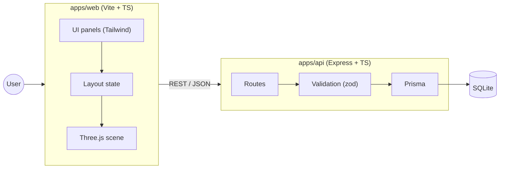

# Architecture Overview

## Goal

A browser-based 3D room planner. Users set a room size, place furniture,
move and rotate it, and save/load layouts.

## System diagram

## Components

| Part           | Responsibility                                                                 |
| -------------- | ------------------------------------------------------------------------------ |
| UI panels      | Furniture catalog, properties panel, save/load. Plain DOM + Tailwind.          |
| Layout state   | Single source of truth for the room and furniture. The scene renders from it.  |
| Three.js scene | Renderer, camera, lights, room meshes, furniture meshes, picking (raycasting). |
| API            | CRUD for layouts. Validates input, talks to the DB through Prisma.             |
| SQLite         | Stores layouts and furniture items in one local file.                          |

## Data flow: saving a layout

1. User clicks **Save**.
2. Web serialises layout state to JSON.
3. `POST /api/layouts` → API validates → Prisma writes to SQLite.
4. API returns the saved layout with its `id`.

## Key decisions

- [ADR 0001: Plain Three.js instead of React Three Fiber](decisions/0001-plain-threejs.md)
- [ADR 0002: SQLite with Prisma](decisions/0002-sqlite-prisma.md)

## Non-functional goals

- Smooth rendering: 60 fps with ~50 furniture items.
- No memory leaks: dispose geometries/materials when objects are removed.
- Secrets only in `.env`, never in the front end.
