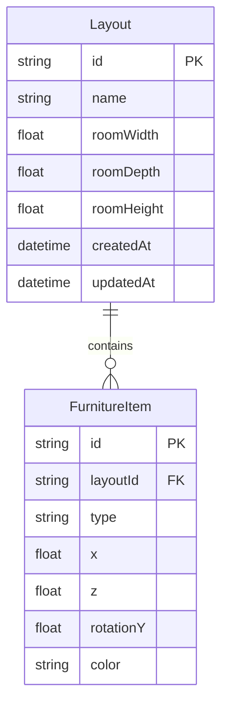

# Data Model

## Conventions

- Units: **metres**. Rotation: **radians** around the Y axis.
- Coordinates: Three.js default, **Y is up**. The floor is the X–Z plane.
  Room centre is (0, 0, 0).

## Entities

## Rules

- `roomWidth`, `roomDepth`: 1–20 m. `roomHeight`: 2–5 m.
- `type` is one of: `sofa`, `table`, `chair`, `bed`, `desk`.
  Sizes per type are defined in the front-end catalog, not the DB.
- Deleting a Layout deletes its FurnitureItems (cascade).
- `color` is a hex string like `#aabbcc`.
